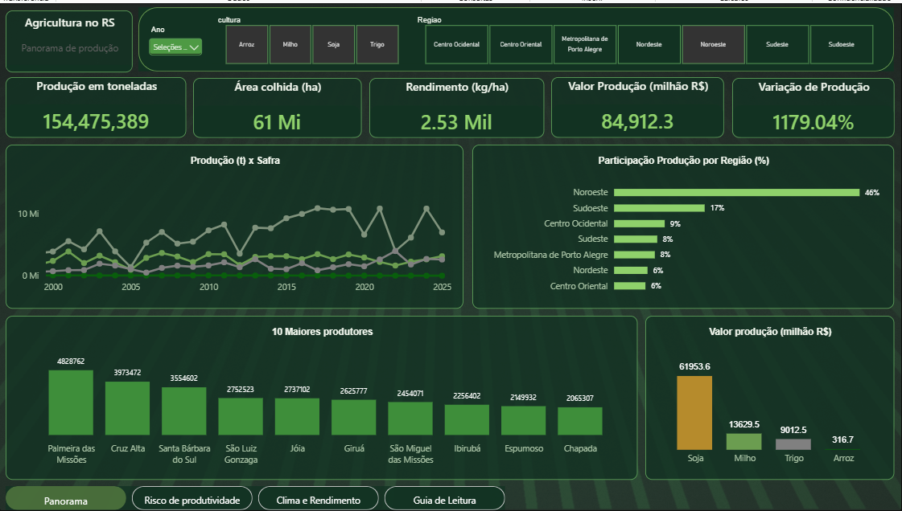
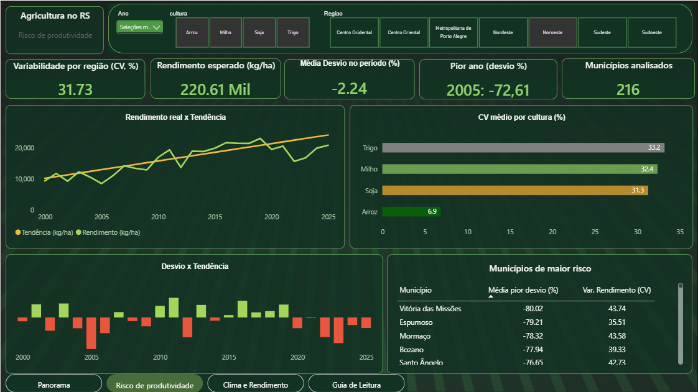
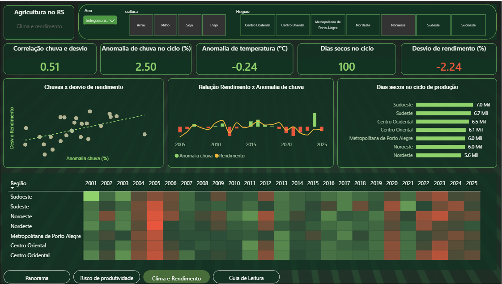

# Crop Yield Risk in Rio Grande do Sul: Public Data and a Decision Dashboard

An analysis of yield risk for soybean, maize, rice and wheat across the 497 municipalities of Rio Grande do Sul (Brazil), built from public data (IBGE and ERA5 climate reanalysis) and delivered as a four-page Power BI dashboard for credit, cooperative and agricultural-policy decision makers.

> **Main finding:** risk has two faces. **Droughts** (2005, 2012, 2022) pull yields down across the whole state, while **extreme-rain years** such as 2024 hit only some regions. Rice, which is irrigated, is the stable exception: its yield varies about 6% around trend, against 23–27% for the other three crops.



## Key results

| Metric | Value |
|---|---|
| Scope | 4 crops, 497 municipalities, 68,457 municipality-crop-year records (1974–2025) |
| Yield trend, whole state (kg/ha per year) | soybean +47, wheat +49, rice +133, maize +169 |
| Variation of yield around trend, state level (std. dev.) | rice 5.6%, maize 22.5%, wheat 23.5%, soybean 26.7% |
| Median municipal CV of yield, 2010–2025 | rice 10%, soybean 27%, maize 32%, wheat 32% |
| Worst years, soybean | 2005 (−69% vs trend), 2022 (−48%), 2012 (−41%) |
| Worst years, maize | 2005 (−57%), 2022 (−40%), 2012 (−35%) |
| Worst years, wheat | 2014 (−38%), 2023 (−37%), 2015 (−32%) |
| Correlation, rainfall anomaly vs yield deviation | soybean +0.64, maize +0.56, wheat −0.53, rice −0.28 |
| Concentration (2025) | Noroeste produces 52% of soybean, 60% of maize and 77% of wheat; rice comes from Sudoeste (43%), Metropolitana (23%) and Sudeste (20%) |
| Production value (2025) | soybean R$ 28.3 bn, rice R$ 14.0 bn, maize R$ 5.9 bn, wheat R$ 3.2 bn (nominal) |

## Business question

*Where and when do crops in Rio Grande do Sul yield less than expected, how large are those shortfalls, and how much of them does the weather accompany?*

## Data

| Source | What | Notes |
|---|---|---|
| IBGE, Municipal Agricultural Production (PAM), SIDRA table 5457 | Planted and harvested area, output, yield and value by municipality, crop and year | Downloaded through the SIDRA API. Municipal sums match IBGE's state totals (`code/08`) |
| ERA5 reanalysis through the Open-Meteo archive API | Daily rainfall and temperature, 2000–2025 | Modeled data, **one reference municipality per mesoregion** |
| kelvins/municipios-brasileiros (MIT) | Municipality centroids used by the map | Not redistributed as a file; downloaded by `code/05` |

## Methodology

1. **Yield:** output × 1000 ÷ harvested area. For regions it is area-weighted (sum of output over sum of area).
2. **Trend:** a robust **Theil–Sen** line fitted on 2000–2025 for each crop and region (slope = median of pairwise slopes). It is robust to a few extreme years, unlike ordinary least squares.
3. **Deviation:** observed yield ÷ trend − 1. This is the main risk signal: it removes technology-driven growth and area changes.
4. **Variability (CV):** standard deviation ÷ mean of a municipality's yearly yield, 2010–2025, for municipality-crop pairs with at least 10 years of data and 500 ha of average harvested area (1,093 pairs).
5. **Climate:** daily data aggregated over each crop cycle (soybean Nov–Mar, maize and rice Oct–Mar, wheat Jun–Nov). Rainfall anomaly in % and temperature anomaly in °C against the 2001–2025 mean of the same crop and region; dry days are days with less than 1 mm.
6. **Association:** Pearson (with Spearman as a check) between rainfall anomaly and yield deviation.

Details and formulas: [`docs/methodology.md`](docs/methodology.md).

## Dashboard

Four pages, in Portuguese (the audience is Brazilian), with a dark-green theme:

| Page | Purpose |
|---|---|
| **Panorama** | Production, area, yield, value and change vs previous harvest; share by mesoregion; top 10 producing municipalities |
| **Risco de produtividade** | Trend vs actual yield, deviation by year, worst year, municipal CV map and ranking of riskiest municipalities |
| **Clima e Rendimento** | Rainfall and temperature anomalies, dry days, correlation, scatter and a mesoregion × year heatmap of deviations |
| **Guia de leitura** | Plain-language dictionary: what each indicator is, how it is calculated, how to read it and how to use it in a decision |




Interactions: year, crop and mesoregion slicers; tooltip pages; no region selected means the whole state. DAX and model notes: [`docs/power_bi_measures.md`](docs/power_bi_measures.md). Theme and background: [`dashboard/`](dashboard/).

## A reading example: soybean in 2024

For the state, soybean yield was only 6% below trend, which looks mild. By region the picture splits: Sudeste −40%, Metropolitana de Porto Alegre −28%, Sudoeste and Centro Oriental −15%, Noroeste +7%. Rainfall was above normal in every region (from +7% to +67%), so the weather data alone does not explain the regional pattern: the relationship between rain and yield is not linear, and too much rain can coincide with losses just as drought does.

## Limitations

- Yield is a municipal annual average; it hides differences between farms.
- Climate comes from **one modeled point per mesoregion**; local rainfall can differ considerably.
- Windows differ by design: yield series 2000–2025, CV 2010–2025, climate 2001–2025.
- Crop cycles are assumed. Annual data cannot capture when rain falls inside the cycle.
- Correlation is not causation, and the seven regions in the same year are not independent observations.
- Production value is nominal (not inflation-adjusted).
- Municipal boundaries for the map are not included; one municipality (Pinto Bandeira) has no polygon in the boundary file used.

## Repository structure

```
├── code/                  numbered scripts (see below)
├── data/
│   ├── powerbi/           tables loaded by the dashboard
│   ├── raw/               daily climate and municipality-mesoregion map (PAM raw file is regenerated)
│   └── validation_sum_of_municipalities_vs_ibge_rs.csv
├── dashboard/             Power BI file and page background
├── docs/                  data dictionary, methodology, DAX, Portuguese indicator guide
└── images/                dashboard screenshots
```

## How to reproduce

```bash
pip install -r requirements.txt
python code/01_collect_pam.py                    # IBGE PAM -> data/raw/pam_rs_raw.csv (a few minutes)
python code/02_build_municipality_mesoregion.py  # municipality -> mesoregion
python code/03_process_pam.py                    # tidy fact table
python code/04_build_risk_tables.py              # trend, deviation, CV
python code/05_add_coordinates.py                # municipality coordinates
python code/06_collect_climate.py                # ERA5 via Open-Meteo (daily request limit applies)
python code/07_process_climate.py                # cycle climate x yield deviation
python code/08_validate_against_state_totals.py  # sanity check against IBGE totals
```

Running the scripts regenerates the files in `data/powerbi/` exactly. Column names are in Portuguese to match the Power BI model; the [data dictionary](docs/data_dictionary.md) explains each one.

## Tools

Python (pandas, NumPy, SciPy), Power BI (DAX, tooltip pages, conditional formatting, maps), SIDRA and Open-Meteo APIs, Git.

## Sources and attribution

- IBGE, Pesquisa Agrícola Municipal (PAM), tabela 5457, SIDRA: https://sidra.ibge.gov.br/tabela/5457
- Weather data by [Open-Meteo.com](https://open-meteo.com/) (CC BY 4.0), based on the ERA5 reanalysis from the Copernicus Climate Change Service.
- Municipality coordinates: [kelvins/municipios-brasileiros](https://github.com/kelvins/municipios-brasileiros) (MIT).

## Author

Vitor Garcia — [GitHub](https://github.com/vitorgrc) · [Medium](https://medium.com/@vitor.grc89)

Code is released under the MIT License. Data belong to their respective sources.
